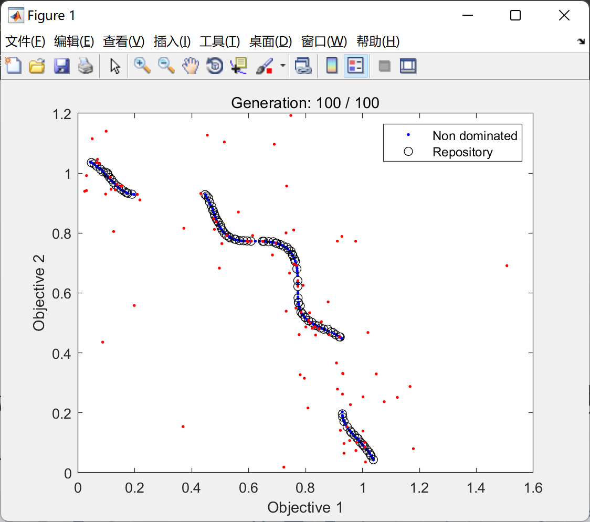
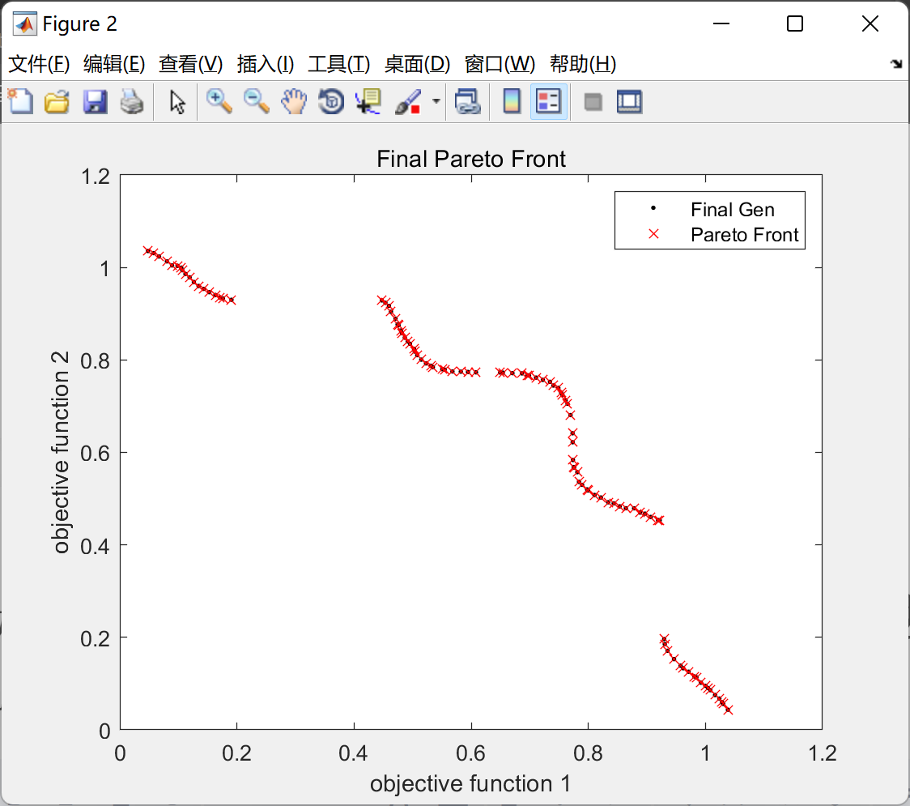
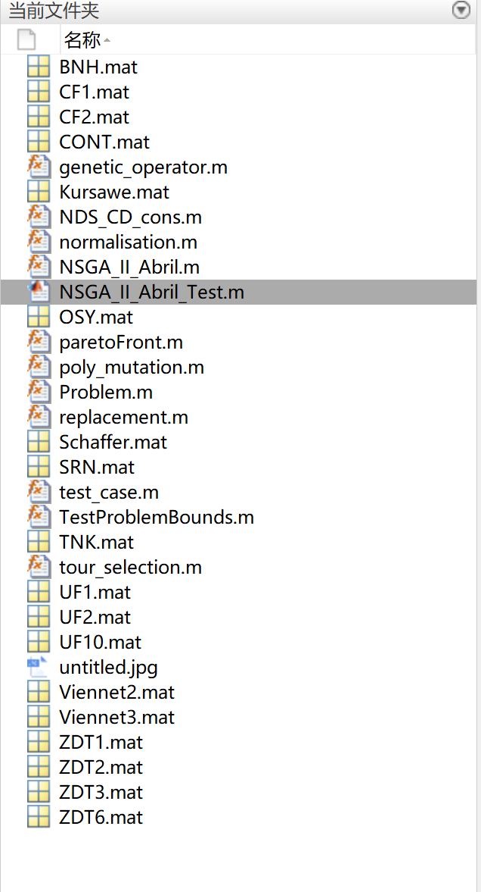

# Multi-objective Optimization NSGA-II (Dominance Sort Commonly Used in Genetic Algorithms) (Matlab Code Implementation)

Multi-objective Optimization NSGA-II (Non-dominated Sorting is common in genetic algorithms) (Matlab code implementation)
\n        \n      \n        \n  
\n        \n

## Images

<!-- PAYMENT_BLOCK -->

## Get this dataset

- Payment link (Stripe): [Buy now](https://buy.stripe.com/3cs8yP7sY87d0vu9AB)
- Payment QR code: 

<!-- /PAYMENT_BLOCK -->
